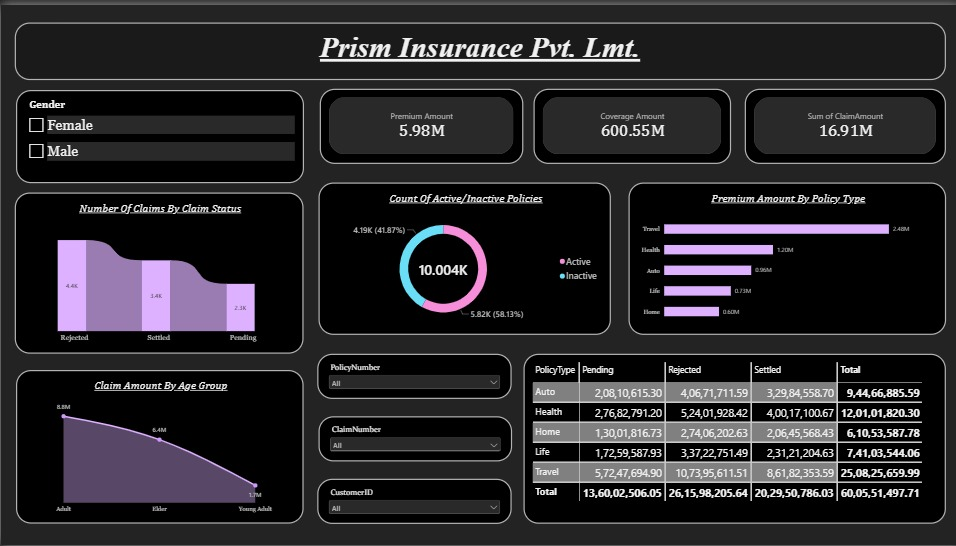
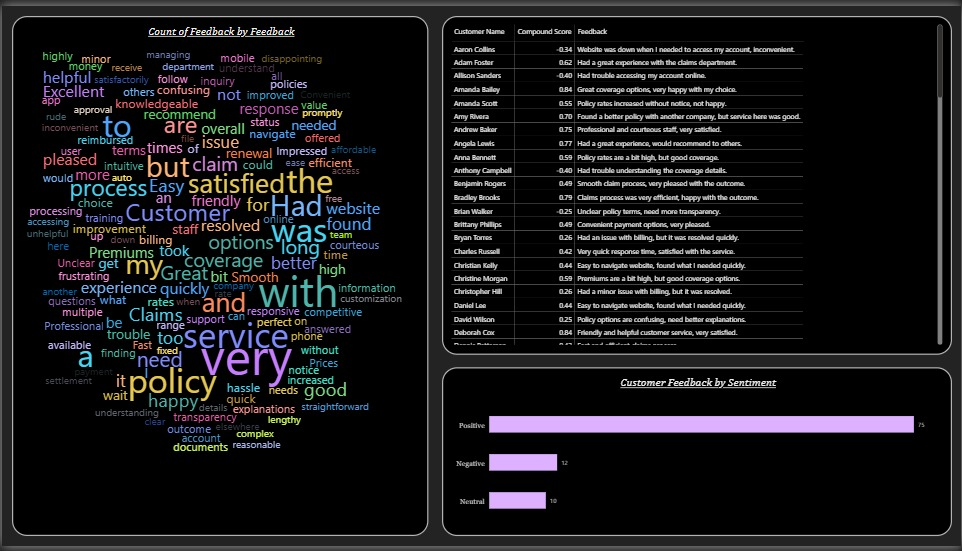
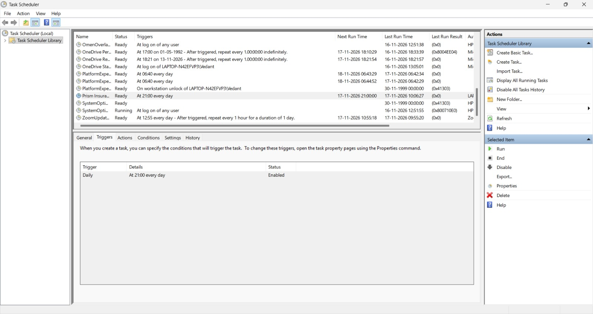
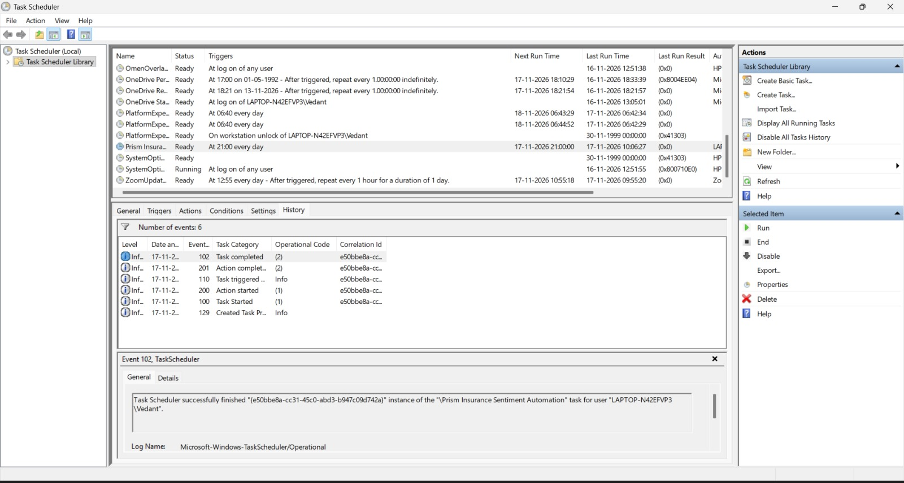

# Prism Insurance Analytics
### Interactive Power BI Dashboard | Python Sentiment Analysis | Task Automation

An end-to-end insurance analytics project combining interactive business intelligence reporting with automated customer feedback sentiment analysis.

## Project Overview

The project focuses on analysing insurance business data and understanding customer feedback through an interactive Power BI dashboard and a Python-based sentiment analysis workflow.

The Power BI dashboard provides insights into insurance premiums, coverage amounts, claims, policy types, customer demographics, and policy status.

To extend the dashboard's analytical capabilities, I developed a separate Python automation workflow using VADER sentiment analysis. Customer feedback is processed and classified into Positive, Negative, and Neutral categories.

The Python script is configured to execute automatically every day at 9 PM using Windows Task Scheduler.

## Dashboard Preview

### Insurance Analytics Dashboard



### Customer Feedback Sentiment Analysis



## Key Features

### 1. Interactive Insurance Dashboard

- Premium amount, coverage amount, and claim amount analysis.
- Claims analysis by claim status.
- Active and inactive policy analysis.
- Premium distribution across policy types.
- Claims analysis across customer age groups.
- Interactive filtering using gender, policy number, claim number, and customer ID.

### 2. Customer Feedback Sentiment Analysis

- Processed customer feedback using VADER.
- Classified feedback into Positive, Negative, and Neutral categories.
- Generated compound sentiment scores.
- Created a word cloud to explore frequently occurring feedback terms.
- Visualised sentiment distribution in Power BI.

### 3. Python Automation

- Developed a Python script to automate sentiment analysis.
- Used a Windows batch file to execute the script.
- Configured Windows Task Scheduler for daily execution at 9 PM.
- Exported processed sentiment results to Excel.

### Automation Evidence





## Technology Stack

| Technology | Application |
|---|---|
| Power BI | Interactive dashboard and visualisation |
| Python | Sentiment analysis automation |
| VADER | Sentiment classification |
| VS Code | Python development |
| Microsoft Excel | Input feedback and output results |
| Windows Task Scheduler | Scheduled execution |

## Project Workflow

**Insurance Data → Power BI → Interactive Business Insights**

**Customer Feedback → Python → VADER → Excel Results → Power BI Refresh**

The scheduled Python workflow updates the Excel output automatically. Power BI requires a separate refresh to display the latest sentiment results.

## Repository Structure

```text
Prism-Insurance-Analytics/
│
├── Dataset/
│   ├── Insurance-Customer-Feedback.xlsx
│   ├── Insurance_Sentiment_Results.xlsx
│   └── README.md
│
├── PowerBI/
│   ├── Prism Insurance Project Final.pbix
│   └── README.md
│
├── Python-Automation/
│   ├── sentiment_analysis.py
│   ├── run_sentiment.bat
│   ├── requirements.txt
│   └── README.md
│
├── Screenshots/
│   ├── dashboard-overview.png
│   ├── sentiment-analysis.png
│   ├── task-scheduler-configuration.jpg
│   └── task-execution-history.jpg
│
└── README.md
```

## How to Run the Python Automation

1. Install Python on your system.
2. Install the dependencies listed in `Python-Automation/requirements.txt`.
3. Place the customer feedback Excel file in the input location expected by the script.
4. Execute `sentiment_analysis.py` or use `run_sentiment.bat`.
5. Check the generated Excel file for sentiment classifications and compound scores.
6. Configure Windows Task Scheduler to run the script automatically.

Update file paths in the script and batch file if your local folder structure differs.

## Key Learning Outcomes

- Developing interactive Power BI dashboards.
- Analysing insurance business data.
- Applying sentiment analysis using VADER.
- Integrating Python processing with Excel-based reporting.
- Automating repetitive data analysis workflows.
- Scheduling Python scripts using Windows Task Scheduler.

## Important Note

- The Power BI dashboard requires a separate refresh to display updated sentiment results.

---

**Project:** Prism Insurance Analytics  
**Focus Areas:** Business Intelligence | Data Analysis | Python Automation | Sentiment Analysis
